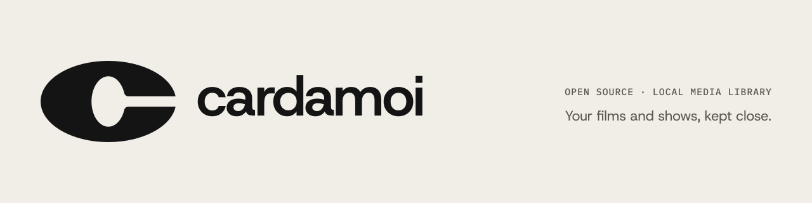

<picture>
  <source media="(prefers-color-scheme: dark)" srcset="brand/assets/social/readme-banner-dark-1280x320@1280.png">
  
</picture>

# cardamoi

A desktop app for finding, downloading and watching films and TV. It keeps a local library, plays it in [mpv](https://mpv.io) with resume and next-episode autoplay, and finds subtitles from OpenSubtitles and Subdl.

Built with [Tauri 2](https://tauri.app), Vue 3 and Rust. Torrents are handled by [librqbit](https://github.com/ikatson/rqbit); search goes through a bundled [Prowlarr](https://prowlarr.com) or any Torznab endpoint you add. Catalog data comes from [TMDB](https://www.themoviedb.org).

Currently developed and tested on macOS (Apple Silicon).

## Requirements

- Node.js 20+
- Rust (stable)
- [mpv](https://mpv.io/installation/), on your `PATH`:
  - macOS: `brew install mpv`
  - Windows: `scoop install mpv` or `choco install mpv`, or download a build from mpv.io and add its folder to `PATH`
  - Linux: your package manager, e.g. `sudo apt install mpv`, `sudo pacman -S mpv`, or `sudo dnf install mpv` (Fedora needs RPM Fusion)

## Setup

```sh
npm install
./scripts/fetch-prowlarr.sh          # arm64 by default; pass x64 for Intel
npm run tauri dev
```

On first launch the app asks for your own free TMDB key (from https://www.themoviedb.org/settings/api) and walks you through getting one. You can change it later in Preferences > TMDB.

Downloads go to `~/Movies/cardamoi`. Videos you copy into that folder yourself are picked up and added to the library.

## Tests

```sh
cd src-tauri && cargo test
```

## Disclaimer

cardamoi does not host or index any content. You are responsible for what you download and for complying with the laws where you live.

This product uses the TMDB API but is not endorsed or certified by TMDB.
